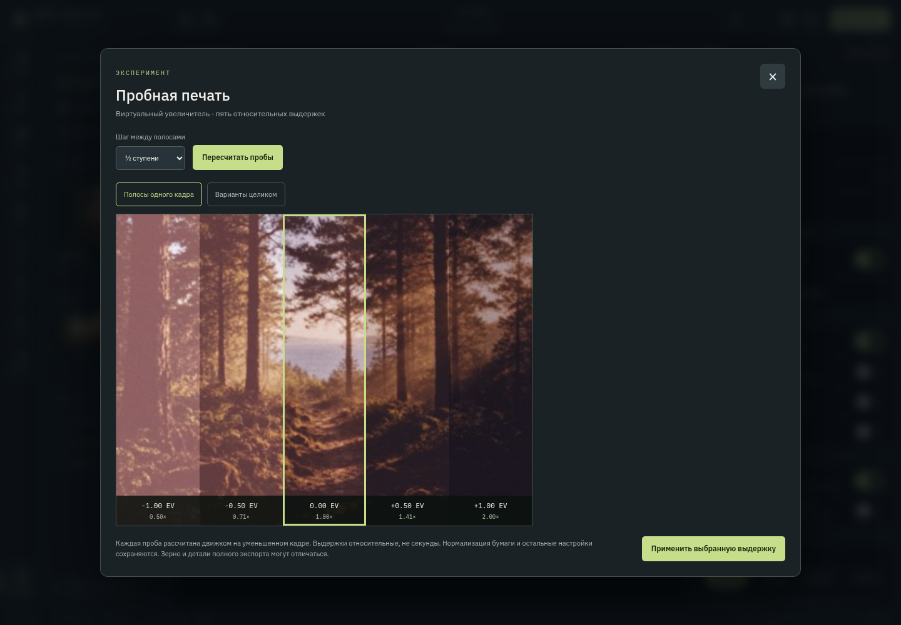
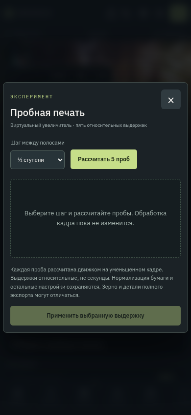

# Experimental test printing — 9.45

## Enable and use

1. Open **Опции → Экспериментальные инструменты → Виртуальный увеличитель**.
2. Open a photo, choose a film and a print paper, and use the print path (not film scanning).
3. Open **Пробная печать** with the flask toolbar button, or **Открыть пробную печать** in Settings.
4. Choose ¼, ½ or 1-stop spacing and calculate five trials.
5. Compare continuous strips or full-frame versions, select a trial and apply it.

The feature is off by default. Exposure is a relative enlarger exposure multiplier,
not calibrated physical seconds. Each strip is the corresponding spatial part of
an independently rendered full frame. Full-frame mode is available for comparing
the same subject in every trial. Values are bounded by the existing print-exposure
range (0.2–3.0); limited values show their actual EV offset.

Applying changes only printExposure, with one normal undo step. Nothing changes
before Apply. Camera exposure, film/paper choice, frame and output settings remain.
Changing the source, settings or spacing invalidates old trials. Closing or cancelling
interrupts the calculation and discards temporary previews.

## Rendering

Browser: existing simulate() pipeline on a 384px proxy from the loaded linear source,
with current crop, orientation, paper and film. Five sequential renders yield between
trials so the dialog remains responsive. Object URLs are disposed on recalculate/close.

Android: a bounded native testPrint plugin method runs five normal native preview
simulations through the existing serialized engine worker. Results are returned as
small JPEGs without writing preview files or publishing gallery images. The previous
last-export JPEG/mime/dimensions are restored in finally. Cancellation/new engine
epochs invalidate the batch. The original cached source file is not changed.

Paper normalization is preserved across trials. A web-engine defect was fixed:
its paper calibration reference incorrectly included the current print exposure,
normalizing away the adjustment. The reference now uses unit print exposure; the
actual paper irradiance still includes the selected exposure. The native C++ engine
is unchanged. Existing web recipes with non-unit print exposure and automatic paper
compensation now respond to that exposure rather than silently cancelling it.

The previews are small experimental proofs; full-resolution grain, diffusion and
fine detail can differ. Native behaviour on a physical Android device has not been
validated in this environment.

## Checks

- Five math/gating/parameter-isolation cases and a real pipeline regression test
  proving longer exposure darkens normalized paper output.
- TypeScript, production web and Android release builds, Android Lint.
- Chromium: opt-in is required, five different engine renders, no parameter mutation
  before Apply, spacing invalidation, apply/undo, Escape, phone layout, cancellation,
  fresh reopen and normal image export after cancelling.

