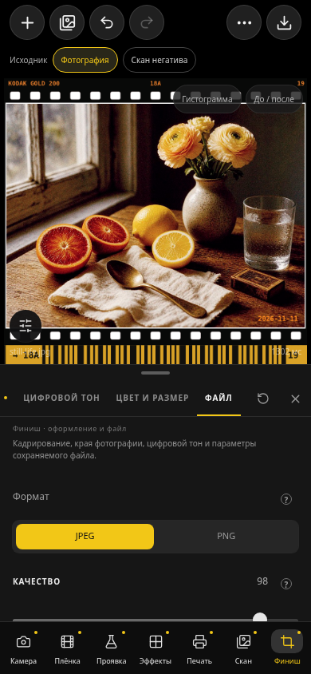

# Рабочее пространство фотографического процесса

Результат: 9.56 / 126. База: 9.55 / 125. Таблица составлена до реализации. Названия проектов остаются атрибуцией моделей и материалов, но не навигацией. Семь разделов доступны в произвольном порядке; это не пошаговый мастер.

## Контрольная таблица переноса

| Старое расположение 9.55                                   | Новое расположение                 | Сохранённые возможности                                                                                                                    |
| ---------------------------------------------------------- | ---------------------------------- | ------------------------------------------------------------------------------------------------------------------------------------------ |
| Плёнки → Все плёнки                                        | Плёнка → Каталог                   | Все материалы, импорт/удаление пользовательских профилей, поиск, избранное, ISO, описание, источник в карточке                             |
| Spektrafilm → Экспозиция                                   | Камера → Экспозиция                | EV, автоэкспозиция, все способы замера                                                                                                     |
| Spektrafilm → Баланс                                       | Камера → Баланс белого             | Режим, K, tint, автоматический баланс, пипетка                                                                                             |
| Spektrafilm → Оптика                                       | Камера → Оптика                    | UV/IR, размытие объектива, диффузия, семейство/сила/PSF                                                                                    |
| Experimental → Спектр и основа: съёмочный фильтр           | Камера → Цветной фильтр            | Все фильтры Hoya                                                                                                                           |
| Negs → Prep                                                | Камера → Подготовка                | EV, света/тени, контраст, lift/gain, Color Boost, насыщенность, локальные детали                                                           |
| Spektrafilm → Формат; Negs → Форматы кадра                 | Плёнка → Формат                    | Пресеты и точный ручной размер одного общего поля                                                                                          |
| Experimental → Спектр и основа: реконструкция              | Плёнка → Спектр                    | Все экспериментальные методы и базовые настройки расчёта                                                                                   |
| Experimental → Спектр и основа: маска                      | Плёнка → Основа и маска            | Включение, плотность, CMY, спектральный наклон                                                                                             |
| Negs → Профиль Negs                                        | Плёнка → Профиль                   | Восстановление зерна/DIR выбранного материала; те же действия возле моделей                                                                |
| Spektrafilm → Push / Pull                                  | Проявка → Push / Pull              | Съёмочная EV, EI, γ, кривые, автозамер, компенсация печати                                                                                 |
| Experimental → Химия плёнки                                | Проявка → Химия                    | Временные профили, быстрые/медленные слои, RGB, истощение, общая γ                                                                         |
| Spektrafilm → DIR; Experimental → Langmuir DIR             | Проявка → DIR                      | Один переключатель эффекта, выбор классической/Langmuir модели, все параметры обеих моделей                                                |
| Spektrafilm → Зерно; Experimental → RMS-зерно              | Эффекты → Зерно                    | Один переключатель, выбор Spektrafilm/RMS, все прежние/RMS параметры, профильные значения                                                  |
| Spektrafilm → Галяция; Fotufilm → Layered Transport        | Эффекты → Галяция                  | Один переключатель, выбор модели, все параметры прежней галяции и слоёв                                                                    |
| Fotufilm → Outputs / Lab Scan                              | Печать → Вывод                     | Бумага, Digital Reference, Auto Levels, Lab Scan, негатив на просвет; все операторские поправки                                            |
| Spektrafilm → Печать                                       | Печать → Бумага и печать           | Каталог бумаги, фильтры/экспозиция/γ, предвспышка, химия, диффузия, блик                                                                   |
| Experimental → Основа бумаги                               | Печать → Основа бумаги             | Временные варианты, плотность, CMY                                                                                                         |
| Spektrafilm → Готовый скан                                 | Скан → Отделка скана               | Прямой скан плёнки, Unsharp, размытие, белая/чёрная точки                                                                                  |
| Experimental → Сканы негативов                             | Скан → Настоящий негатив           | Явный маршрут исходника, три способа конвертации, освещение/экспозиция/порог, маска, матрица, LUT; маска материала также доступна в Плёнке |
| Spektrafilm → Рамка                                        | Финиш → Рамка                      | 135/120/белая кромка, DX, номер, дата                                                                                                      |
| Spektrafilm → Кадрирование                                 | Финиш → Кадрирование               | Поворот, пропорции, размер/X/Y, серый холст                                                                                                |
| Spektrafilm → Цифровой тон                                 | Финиш → Цифровой тон               | Стили, яркость/контраст/света/тени/насыщенность/теплота                                                                                    |
| Ещё → Расчёт: RGB → спектр, Hanatos, спектральное размытие | Плёнка → Спектр                    | Базовый метод и все исходные настройки                                                                                                     |
| Ещё → Расчёт: входной гамут, декод CCTF                    | Камера → Входной цвет              | Те же поля движка                                                                                                                          |
| Ещё → Расчёт: выходной гамут, апскейл                      | Финиш → Цвет и размер              | Все исходные варианты гамута, апскейл                                                                                                      |
| Ещё → Расчёт: LUT превью                                   | Настройки → Производительность     | Точность ускоренного предпросмотра                                                                                                         |
| Ещё → Сохранение файла                                     | Финиш → Файл                       | JPEG/PNG, качество, цветовое пространство, CCTF, сжатие гамута; кнопка экспорта всегда сверху                                              |
| Ещё → Рецепты/Галерея/Очередь/Журнал/Настройки             | Ещё → соответствующее действие     | Сохранение существующих служебных возможностей                                                                                             |
| Настройки → Виртуальный увеличитель                        | Печать → Пробная печать, также Ещё | Включение эксперимента, пять пробных выдержек, применение результата                                                                       |

## Взаимодействие и зависимости

- Основной кадр и контекстная панель образуют один экран; высота панели изменяется. На широком экране панель справа. Последняя страница каждого раздела запоминается.
- Тип исходника виден постоянно: эмуляция плёнки или настоящий негатив. Инструменты калибровки доступны через прямое действие; выбор маршрута явно меняет существующее поле workflow. В браузере указывается ограничение нативной конвертации.
- Модели зерна, галяции и DIR переключаются внутри одного инструмента, сохраняя неактивные значения. Переключение модели не включает эффект само по себе.
- Сброс инструмента охватывает обе его модели и общие поля, не затрагивая соседние инструменты; допускает Undo. Числовой ввод сохраняет прежние диапазоны и шаги.
- Параметры обходящейся стадии видны с причиной и доступным действием перехода/включения. При цифровом выводе бумага обходится; конвертация негативов не применяет съёмочные эффекты.
- Поиск организован по фотографическим разделам. Параметры альтернативной модели находятся в том же инструменте; поиск объясняет, какую модель включить.
- Алгоритмы, Android bridge, исходные профили и формат сохранённых параметров не меняются.

## Проверки

- TypeScript — PASS; production APK web bundle — PASS.
- `check-ux-ranges.mjs` — PASS: 234 существующих определения сохраняют диапазоны, точность, варианты и обработчики. Единственное нормализованное переименование — системный переключатель закрепления журнала вместо удалённого «Расчёта».
- `check-zalupa-engine.mjs` — PASS: движок, данные профилей, bridge и 32 обработчика импорта/просмотра/экспорта сохраняют контракты.
- Новая архитектура, сбросы, зависимости и числовой ввод — 8 тестов PASS. Вместе с app-data/auth — 40 PASS.
- Наборы Experimental, Negs, Outputs и Layered Transport — PASS (36, 41, 15 и 14 проверок соответственно; наборы частично пересекаются).
- Общий `npm test`: 178 PASS / 17 FAIL. Все 17 имён ошибок воспроизведены на нетронутой 9.55 (`35b146d`) в отдельной папке. Причины — отсутствующие ресурсы/инструкции веб-шаблона, app-env и ожидания метатегов; это не новые регрессии фоторедактора. Вторую часть команды app-data/auth запустили отдельно — PASS.
- `test-process-ui.mjs` — PASS: 105 разных названий числовых контролов реально изменены через клавиатуру, точный ввод с запятой, Undo, независимые сбросы, выбор альтернативных моделей, поиск, бумага/цифровой вывод и честное ограничение браузерной конвертации. Проверены 320×568, 360×740, 390×844, 844×390, 1440×1000. JPEG с рамкой действительно скачан: 1 600 129 байт. Ошибок страницы нет.
- `test-process-state.mjs` — PASS: прямой переход к каталогу из инструмента с тем же прежним tool ID; модель RMS и точное значение 19.5 восстановились после перезагрузки и повторного импорта с отключённым сбросом нового кадра.
- Android release — BUILD SUCCESSFUL: ARM64, Android 7+, версия 9.56 / 126. Подпись совпадает с 9.55, ZIP CRC исправен; все три .so побайтово совпадают с 9.55. Встроенные HTML/CSS/JS совпадают с текущей production-сборкой.
- Автоматизированные браузерные проверки не считаются тестированием на физическом Android-устройстве. Полная спектральная обработка и калибровка негативов в браузере не заявляются.

## Самопроверка и исправления

| Конкретная проблема | Исправление / проверка |
|---|---|
| Зерно, галяция и DIR были разнесены по репозиториям | По одному инструменту с явным селектором модели |
| При объединении оставались два переключателя одного эффекта | Встроенные контролы модели используют единый главный переключатель |
| Сброс одной модели мог оставить изменённую альтернативу того же инструмента | Сброс инструмента охватывает обе модели, отдельные тесты проверяют соседние стадии |
| Общие EV, γ и физический размер могли выглядеть независимыми | Общие поля сохранены, связи подписаны, формат пресета сразу отражается в ручном размере |
| Составная панель могла получать справку/defaults от другого старого tool ID | Контекст ControlScope сохраняет исходную семантику контролов |
| HTML fieldset не блокирует пользовательский slider на div при вводе с клавиатуры | Контекст недоступности отключает обработчики/фокус числовых регуляторов |
| Панель на 320×568 выходила на нижнюю навигацию после добавления маршрута | Ограничение высоты учитывает маршрут и оставляет место фотографии |
| Семь разделов могли не помещаться в нижнюю панель | Все семь видимы на 320 px, проверка геометрии кнопок |
| Печать настоящего негатива ошибочно зависела от сохранённого цифрового Output | Зависимость следует ParamsBuilder: negative-print использует бумагу независимо от output.mode |
| Послойную химию можно было ошибочно отключить при конвертации негатива | Сверка C++: она подготавливает кривые исходного профиля и остаётся доступной с объяснением |
| Переход из зерна к каталогу через прежний setTool("film") мог оставаться на том же tool ID | Прямые переходы используют ID страницы, а не только старый ID инструмента |
| Подсказки поиска предлагали удалённые переключатели RMS/Layered/Langmuir | Подсказки называют соответствующий выбор модели в едином инструменте |
| Постоянная полоса масштаба и диагностики перекрывала маленький предпросмотр | Компактная кнопка раскрывает все инструменты просмотра |
| Уведомление о сбросе перекрывало постоянный выбор маршрута | Всплывающее уведомление перенесено ниже полосы маршрута |
| В текстах оставались «Опции», прежнее расположение тона и неверное удержание вкладки для сброса | Обновлены фактические пути и инструкция по круговой стрелке |

## Ограничения и непроверенные гипотезы

- Физического Android-устройства в этой проверке нет; нативные калибровка/конвертация подтверждены сохранностью кода и сборкой, но не новым запуском на устройстве.
- Удобство семи названий и порядок подразделов проверены экспертно и автоматизацией, не реальным пользовательским исследованием.
- При включённом «Сброс на новый файл» параметры нового кадра намеренно сбрасываются согласно прежнему поведению. Для сохранения обработки между файлами этот переключатель отключается в настройках.
- На очень небольшом экране длинные списки параметров прокручиваются; панель можно уменьшить или закрыть. Второго уровня вкладок внутри инструмента нет.

## Артефакт

`SpektrafilmLab-9.56-arm64.apk`: 39 526 456 байт.
SHA-256: `6463227b08163a9cce91c47587e45ad688caba3b48288bb476dded801f593a1e`.

