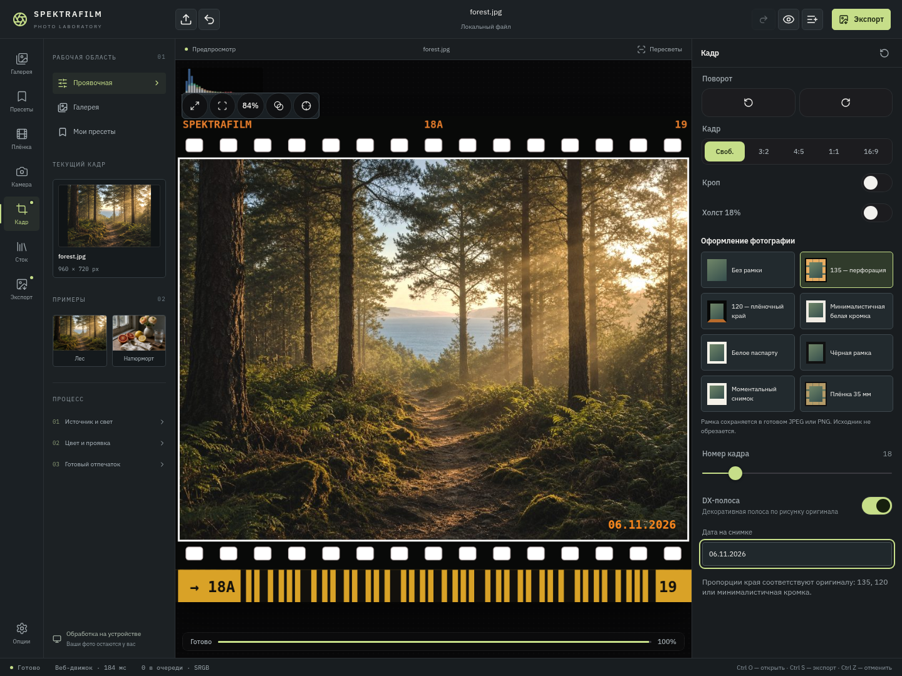
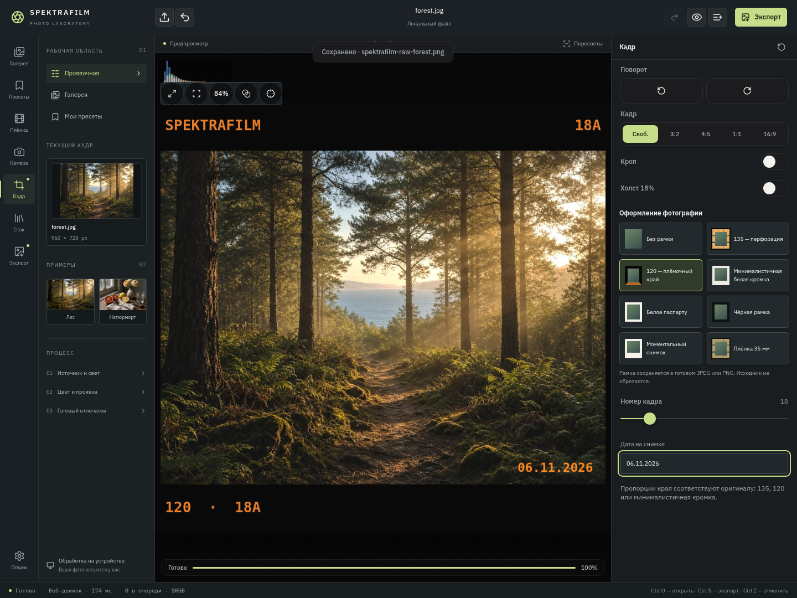

# Original film edges — version 9.44

Open **Кадр → Оформление фотографии**. The only options are:

- No frame.
- 135: perforations, stock lettering, frame number and optional decorative DX stripe.
- 120: lettering and frame number, without perforations or DX.
- Minimal white edge: the original off-white base and lower caption.

Frame number and optional date are available for the three edge styles. DX is a
separate switch for 135. Borders appear in the preview and are composed into
exported JPEG/PNG files. The optional date imprint sits inside the photo, as in
the original implementation.

All earlier custom white/black/instant-photo renderers and the duplicate 35mm
menu item have been removed. Old saved custom styles are reset to no frame;
the former `film` identifier migrates to original 135. No custom-width slider
remains: the original compositor defines each edge's proportions.

## Source

The original implementation is in **spektra-zh**, revision
`80e420ece960c8d7b742ba7d7c15ee033d051b88`,
`app/src/main/java/com/spectrafilm/app/FilmEdge.kt` in
[hwx959/Spektrafilm-android](https://github.com/hwx959/Spektrafilm-android/tree/spektra-zh).
Our earlier review checked only main and incorrectly claimed no ready compositor
existed. That conclusion was corrected in version 9.43.

Android delegates only to the copied Kotlin compositor, adapted for the package
name/imports/comments and without the Compose-language UI. Browser preview/export
uses a Canvas port of its geometry, colours and drawing commands. Attribution is
in THIRD_PARTY_NOTICES.md and About. Controls are Russian.

The DX band reproduces the original decorative pattern; it is not a scanner-readable
encoded DX identifier. Browser/native text rasterization can differ. Physical-device
rendering remains untested here.

