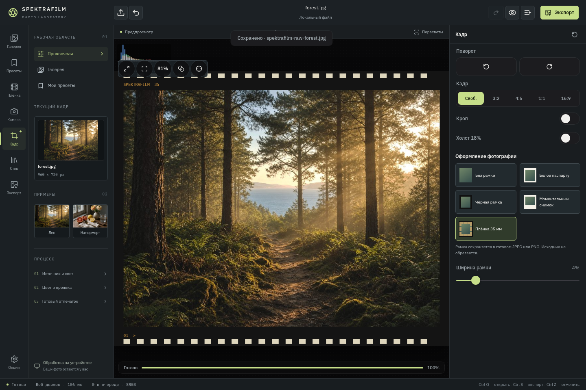
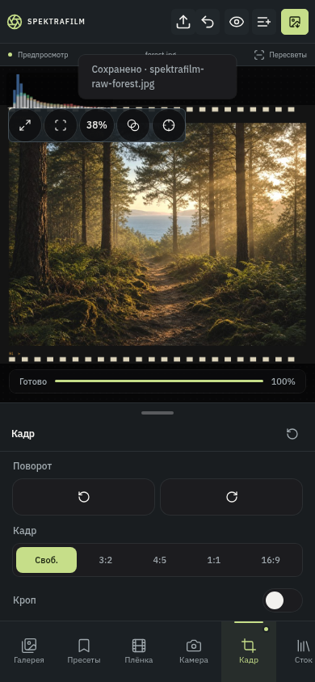

# Photo frames — version 9.42

Open **Кадр → Оформление фотографии**. Choose no border, white mat, black mat,
instant-photo border, or a 35mm-style border with perforations and markings.
Width is 1–20% of the shorter image edge. Borders are added outside the photo,
after rotation/crop; they do not crop or cover the photo's pixels. Output dimensions
therefore grow. No border is the default for existing edits.

The UI previews the composed image. JPEG/PNG export and the browser stock queue
compose the border with the same Canvas geometry. The native export worker
composes it on the final Bitmap before encoding, records the new dimensions and
then uses the verified gallery publisher. Browser-processed photos saved through
the native bridge already contain their border and are not framed twice.

The feature is a new implementation in this project. Inspection of
hwx959/Spektrafilm-android at 15fb120 found stock-selection cards and viewer icons,
but no ready-made photographic-border/export implementation to copy.

Pixel inspection tools (zebra/probe) are unavailable on the framed preview; return
to no frame to inspect the simulation's pixels. The histogram describes the
processed photo, excluding its decorative border.

Validation: six frame geometry/sanitization tests; TypeScript, production web
build, Android release build and Android Lint; Chromium checks for all four
styles, downloaded JPEG dimensions and edge pixels, a real PNG download and its dimensions, desktop and phone layout.
Physical-device frame composition has not been tested here. Browser/native text
rasterization may differ; image placement, widths and border colours follow the
same formulas.

