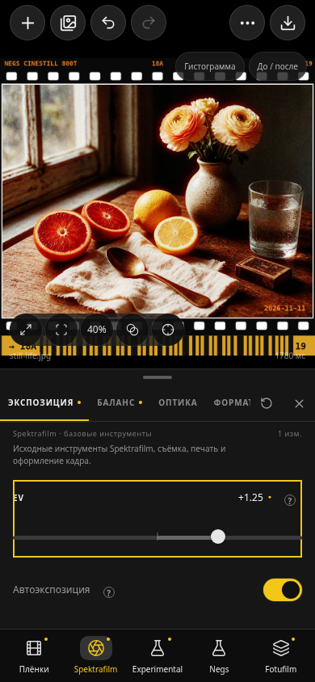

# Инструменты по источникам · 9.55 / 125

Дизайн Zalupa сохранён. Функциональная навигация 9.54 заменена пятью основными вкладками, чтобы алгоритмы разных проектов не оказались в одном списке. Открытие вкладки не меняет параметры или движок.

| Вкладка | Что находится внутри |
|---|---|
| Плёнки | Общий каталог: исходные, Experimental, Negs, свои материалы. Поиск, категории, избранное и импорт сохранены. |
| Spektrafilm | Исходные экспозиция/баланс/оптика/формат, прежнее зерно и галяция, линейный DIR, Push / Pull, обычная бумага/печать и финиш скана, рамки, кроп и цифровой тон. |
| Experimental · Spektrafilm | Спектральная реконструкция, съёмочные цветные фильтры и основа плёнки; послойная химия и времена проявки; RMS-зерно; Langmuir DIR; спектральная основа бумаги; конвертация сканов настоящих негативов. |
| Negs | Prep, готовые форматы кадра и восстановление зерна/DIR из выбранного профиля Negs. Ручных контролов других проектов здесь нет. |
| Fotufilm | Outputs / Digital Reference / Auto Levels / Lab Scan и послойная галяция Layered Transport. |

## Происхождение и общие параметры

RMS и Langmuir были перенесены из Spektrafilm experimental ещё в 9.48: см. [EXPERIMENTAL_PARITY.md](EXPERIMENTAL_PARITY.md). Negs в 9.49 добавил свои материалы и профильные значения для этих моделей, а также Prep и форматы: см. [NEGS_INTEGRATION.md](NEGS_INTEGRATION.md). Поэтому ручное управление моделями принадлежит Experimental, а кнопки восстановления данных Negs — Negs → Профиль Negs. Выбор плёнки по-прежнему применяет её исходные значения в существующем движке.

Мягкость и облака зерна, общий DIR strength/reach и размер кадра — существующие общие поля движка. Их регулировки не исчезли с удалением смешанной страницы «Фактура · все модели»: общие строки зерна/DIR доступны также рядом с соответствующей моделью Experimental. Это те же значения, а не независимые копии состояния.

Общая γ на странице послойной химии совпадает с коэффициентом Push / Pull. Форматы Negs меняют тот же физический размер, что и ручной формат Spektrafilm. Измеренное время — вариант профиля, поэтому семейства материалов Negs доступны и при настройке общей химии. Плёнки и их профили остаются общими данными.

В базовой печати больше нет перенесённой настройки спектральной подложки. В базовом Push / Pull нет послойной химии. «Расчёт» и настройки приложения больше не содержат входа в спрятанный склад Experimental.

## Поиск, активные состояния и сброс

Поиск использует ту же карту страниц и источников, что нижняя навигация. Результаты сгруппированы по источнику, доступны фильтры источника и изменённых страниц. Поиск RMS открывает Experimental, Layered Transport — Fotufilm, Prep — Negs.

Сброс базового Push / Pull не очищает экспериментальную химию; сброс базовой печати не трогает основу бумаги Experimental. Неактивные прежние модели показывают переход к действующему владельцу; их кнопка сброса скрыта, чтобы она не сбросила общие параметры чужой активной модели. Профиль Negs имеет явные кнопки восстановления вместо общего сброса страницы.

Сохранённые настройки не мигрируются и не очищаются. Формулы, данные плёнок, формат пресетов, Android bridge и 32 обработчика импорта/обработки/экспорта не менялись.

## Проверки

Результаты итоговой проверки, сборки и скачивания приводятся ниже. Это автоматизированная браузерная проверка и проверка сборки; физическое Android-тестирование и пользовательское исследование не заявляются.

- TypeScript и production web build — PASS.
- `check-ux-ranges.mjs` — 234 исходных определения без изменения диапазонов/шагов/вариантов/значений/обработчиков.
- `check-zalupa-engine.mjs` — движки, профильные данные, bridge и 32 обработчика приложения/эффекты рендера неизменны.
- `zalupa-navigation.test.ts` + `control-number.test.ts` — 8 проверок проходят, включая владельцев страниц, переход из неактивной модели, независимость сбросов и точность чисел.
- `TEST_URL=http://127.0.0.1:8092/ node scripts/test-zalupa-ui.mjs` — PASS на production-сборке. Проверены реальные файловый импорт, пять источников, отсутствие RMS/химии в чужих меню, общие строки зерна/DIR, восстановление CineStill Negs после ручной правки, бумага/подложка, Lab Scan, Layered Transport, рамка/дата/DX, поиск с фильтром источника, Undo и настройки UI. JPEG реально получен: 1628×1536, 1 395 462 байта. Ошибок страницы нет.
- Геометрия 320×568, 360×740, 390×844, 844×390 и 1440×1000 — PASS; изображение с рамкой помещается в оставшийся холст.

Android release build — BUILD SUCCESSFUL, 9.55 / 125, ARM64, minSdk 24. ZIP CRC, версия и подпись проверены. Все три нативные .so побайтово совпадают с 9.54. Размер 39523044 байт; SHA-256 `157cddbf03dc95c192e24bed46622484938b7ba068ea5f1ae4b4d7aed746b611`.
