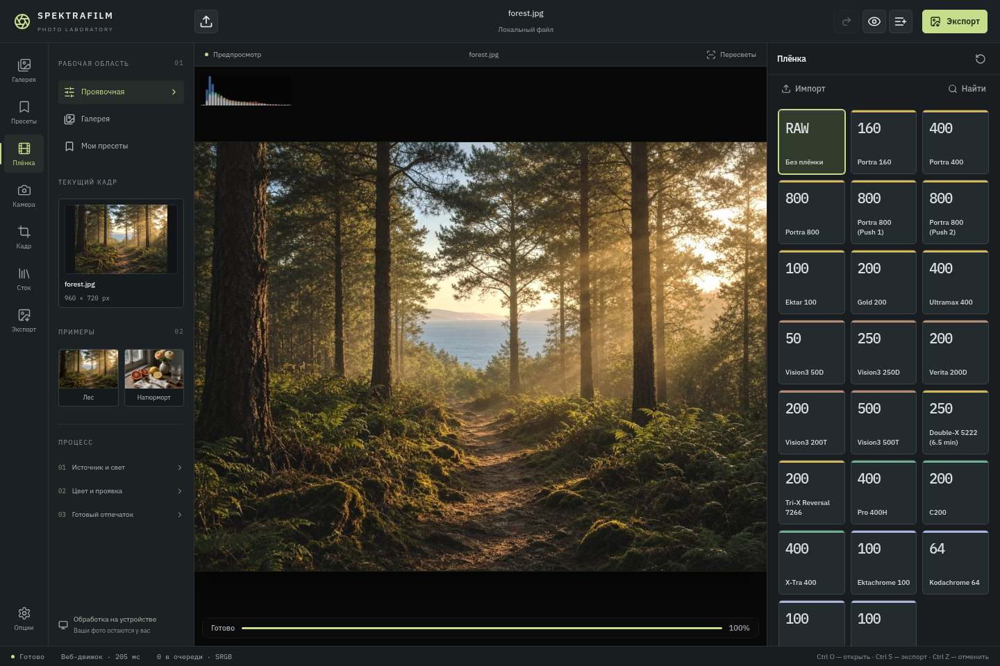
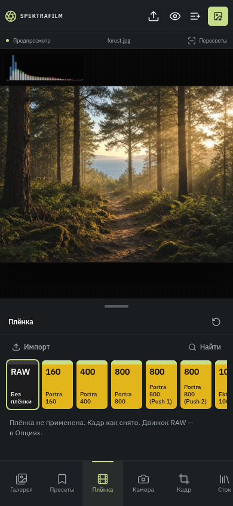

# Spektrafilm 9.40 workbench

The editor uses a desktop workspace at 1100 CSS pixels and above: tool rail,
source library, preview and inspector. Smaller screens retain a touch panel and
scrollable tool navigation. The photo-processing engines are unchanged.

## Commands

- Open a file: toolbar, drag and drop, or Ctrl/Cmd O.
- Export: green toolbar button or Ctrl/Cmd S. The Export tool controls format,
  quality and output colour space.
- Undo/redo: Ctrl/Cmd Z and Ctrl/Cmd Shift Z, or toolbar actions. Text inputs
  retain their native undo behaviour.
- Compare: hold the eye button with a pointer, Space or Enter. Escape returns
  to the edited image and exits immersive view.

## Development

Use the unpacked repository root (package.json), rather than extracting the
historical spektrafilm.zip over it. The ZIP is retained as the original import.

```sh
npm ci
npm run dev
npm run typecheck
npm run build
node --experimental-strip-types src/lib/film/gallery.test.ts
```

For Android, install JDK 17, SDK platform 34 and build tools 34, NDK 26.1.10909125,
CMake 3.22.1 and platform-tools. Set JAVA_HOME and ANDROID_HOME, then run:

```sh
bash scripts/build-apk.sh
```

The APK is written to artifacts/SpektrafilmLab.apk. GRADLE_BIN can select an
existing Gradle 8.2.1 installation. The wrapper remains the default. This is an
ARM64 release build with the project's debug signing configuration.

## Corrected defects

- Browser exports without a native URI no longer remove earlier gallery shots.
- Gallery storage fallback drops older entries without truncating JPEG data URLs.
- Global undo does not consume keyboard shortcuts inside editable controls.
- The file input is cleared after selection so the same file can be opened again.
- CR3 and HEIC extensions are included in the file picker.
- Export settings are reachable from the tool rail.
- The before/after button supports keyboard hold, release and blur.
- Android download uses the actual Releases page instead of silently checking
  absent local APK/ZIP files.
- Android build commands resolve their project directory relative to the script.

## Validation and limits

TypeScript checking and the web production build passed. Gallery regression tests
cover independent browser exports, native URI replacement and the gallery cap.
Selected existing processing tests pass. Chromium checks cover image loading,
keyboard comparison, JPEG download and layouts at 1440x960, 390x844, 320x568,
844x390 and 820x1180. Physical Android-device behaviour is not verified here.

The pre-existing template test failures involving missing .grok fixtures and the
missing attachments/07 C200 modern.json are separate from these changes; no test
assertions were disabled to hide them.

## Screenshots




