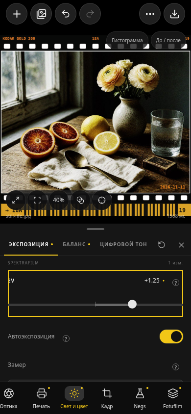
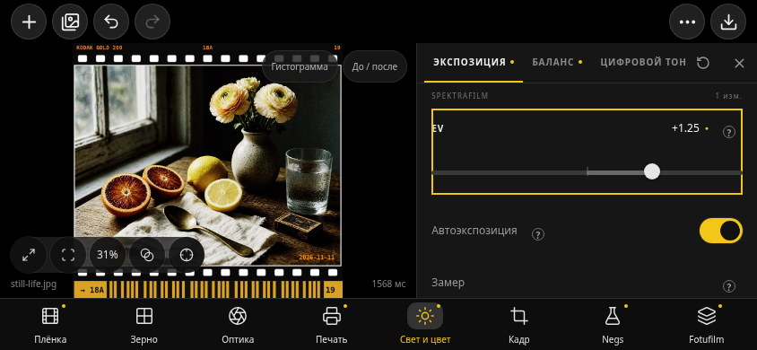

# UI из Zalupa · Spektrafilm Lab 9.54

Пользователь попросил взять только UI из `komarpunk-design/Zalupa`. В `main` этого репозитория находится только `.github/workflows/android.yml` (186a467980647f50c5d2da037ac61c3c6a02135c). Workflow собирает `DhaliwalX/fotufilm-engine`. Исследован и зафиксирован его коммит **8aa050b63e0fbba61ac5b95330008e9f1dd489f9**, Flutter UI, а не прежний китайский Spektrafilm-android.

## Что перенесено

Адаптация исходных Dart/Flutter виджетов на React/CSS для существующего Capacitor-приложения. Flutter и второй движок не добавлялись.

| Исходный UI | Адаптация |
|---|---|
| `ui/phone/phone_editor.dart` | Круглые Add/Library/Undo/Redo/More/Export, фотография, панель с ручкой, горизонтальные вкладки и нижние группы. Повторное нажатие группы закрывает панель. |
| `model/phone_decks.dart`, `ui/phone/deck_pages.dart` | Группа → её страницы, запоминание страницы при переключении групп. Наши дополнительные модели вынесены в Negs и Fotufilm. |
| `ui/phone/phone_films.dart` | Категории, горизонтальные квадратные фотокарточки со скруглением, подпись выбранной плёнки и избранное. Тот же компонент используется для бумаги. Поиск и импорт наших профилей сохранены. |
| `ui/kit/adjustment.dart` | Плоские строки параметров: название, числовое значение, светлый круглый бегунок, локальная справка. Точный ввод и диапазоны прежние. |
| `ui/theme/phone.dart` | Чёрный холст, панели #161616, нижняя полоса #0d0d0d, жёлтый #f2c717, круглые кнопки. Размеры адаптированы с учётом исходного touch scale 1.25. |
| `ui/theme/palette.dart`, `metrics.dart` | Серо-синяя desktop-палитра, боковой инспектор в большом и горизонтальном окне. |
| `FlatSections` | Внутри страницы нет дополнительных вложенных подменю: разделы показываются плоско. |

Добавлены страницы, соответствующие **нашим** возможностям. Несуществующие HDR/локальные инструменты, видео и плагины донора не выдаются за работающие функции.

Верхняя кнопка «Ещё» содержит рецепты, очередь, поиск параметров, настройки, расчёт, журнал и прежнюю фактуру со всеми моделями. Здесь же сохраняются добавление в очередь, экспериментальная пробная печать и явный сброс. Глобальный сброс требует двух последовательных нажатий. Сброс страницы экспозиции не сбрасывает баланс и оптику; сброс Outputs не меняет Layered Transport.

## Граница переноса

- `src/lib/film`, Android native source и `public/profiles` не изменены относительно a17e3bd. Имеющиеся Spektrafilm / Negs / Fotufilm алгоритмы остаются прежними.
- 32 обработчика приложения и эффекты рендера сохранены: загрузка, нативный picker, RAW, баланс, очередь, пробная печать, экспорт и отмена. Проверка: `scripts/check-zalupa-engine.mjs`.
- Никакие чужие профили, FFI, Swift, Halide, Vulkan или C++ из Zalupa не добавлялись.
- Генерируемые шрифты Satoshi и отдельно лицензированные рисунки glyphs не находились в исходном checkout и не копировались. Использованы имеющиеся Lucide и системный шрифт. Это адаптация UI, не побитовое встраивание Flutter.
- В карточке выбранной плёнки показывается текущий результат. Остальные используют исходник; фоновые индивидуальные проявки всех миниатюр не добавлены. Они не имитируются CSS-фильтрами.
- Android Back, IME, TalkBack и поведение на физическом устройстве требуют отдельной проверки. Подтверждения пользовательского исследования нет.

Apache-2.0, NOTICE и источник адаптации сохранены в `docs/upstream/zalupa-ui`; APK содержит `zalupa-ui-notice.txt`.

## Проверка

Команды и результаты итогового прогона фиксируются ниже после сборки. Браузерный тест проверяет производственный `dist-apk`, а не отдельный макет.

- `npm run typecheck` — проходит.
- `node scripts/check-ux-ranges.mjs` — 234 исходных определения контролов сохранили диапазоны, шаги, варианты, значения и обработчики.
- `node scripts/check-zalupa-engine.mjs` — неизменны движок, мост и профили; сохранены 32 обработчика приложения и эффекты рендера.
- `node --experimental-strip-types --test --test-isolation=none src/components/darkroom/zalupa-navigation.test.ts src/lib/film/control-number.test.ts` — 5 проверок проходят: маршрутизация, независимые сбросы страниц/источников и точность чисел.
- `npm run test:transport` — 14/14; `test:outputs` — 15/15; `test:negs` — 41/41; `test:experimental` — 36/36. Эти группы частично перекрываются.

В браузерной проверке обнаружены и исправлены: вертикальный сдвиг панели при центрировании карточки; одинаковые доступные имена одноимённых стандартных и experimental материалов; изменение имени вкладки из-за индикатора; старое ограничение высоты фото, обрезавшее рамку при маленьком холсте; подсказки поверх переключателей; старые настройки подписей и закрепления, которые требовали подключения к новой панели. Убрана отдельная строка импорта над лентой — импорт и поиск стоят в одном ряду.

Это экспертная проверка и автоматизация, не тестирование на людях. Полный `npm test` имел в исходном 9.53 178 успешных проверок и 17 ошибок старого веб-шаблона; этот UI-перенос их не исправляет и не выдаётся за прохождение всего набора.

Итоговый `node scripts/test-zalupa-ui.mjs` — PASS. Проверены реальный файловый импорт, выбор стандартной плёнки и бумаги, числовой ввод/сброс/Undo, независимые страницы, Negs, Outputs/Lab Scan, Layered Transport, рамка 135/DX и дата, прямой поиск, скрытие/открытие панели, подписи и закрепление служебных разделов. Проверены 320×568, 360×740, 390×844, 844×390 и 1440×1000; не только контейнер, но и **всё изображение с рамкой** помещается в холст. Реально скачанный JPEG — 1628×1536, 1 499 844 байта. Ошибок страницы нет.

`bash scripts/build-apk.sh` — BUILD SUCCESSFUL. Android 9.54 / versionCode 124, ARM64, minSdk 24. ZIP CRC и apksigner проверены. Сертификат совпадает с прежними сборками. **Все три .so (libc++_shared, libsfraw, libspektra) побайтово совпадают с APK 9.53**.

Размер APK: 39521880 байт. SHA-256: `6da0c63aba7575e14342a436609c2e7b1074bff7707a60c9dd6687efdd72250d`.

Снимки реального браузерного сценария после прямого перехода к EV (жёлтая рамка — временная подсветка найденного параметра):

